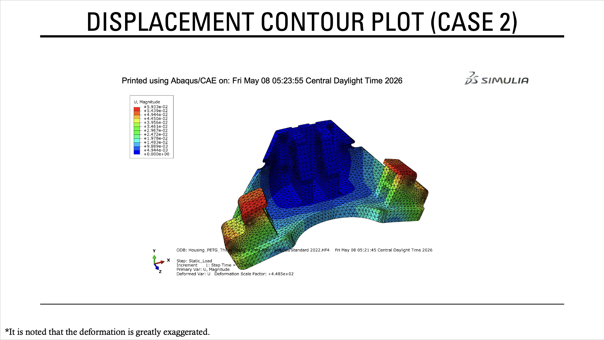
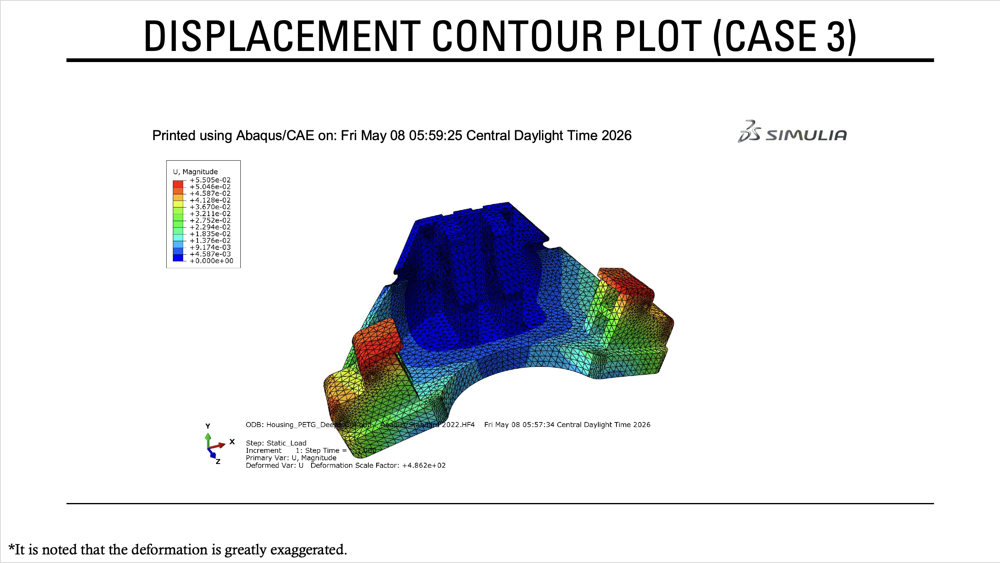

# Tooling Housing | Structural FEA & Design Optimization

**Software:** Abaqus/CAE, MATLAB  
**Focus:** Mechanical Design, Finite Element Analysis (FEA), Structural Optimization

## Project Overview

This project involved the structural analysis and optimization of a PETG housing used in a semi-automatic electromechanical tooling fixture. The housing supports and secures the tooling and linear actuators, which generate reaction forces during operation.

The objective was to reduce the housing's mass while keeping von Mises stress and displacement within specified limits and maintaining the clearance needed for surrounding components.

### Tooling Housing Overview

The housing includes mounting interfaces for the tooling and linear actuators.

---

## Engineering Approach

### 1. Structural Analysis — Abaqus/CAE

I used Abaqus/CAE to evaluate the housing's structural behavior under the expected reaction loads.

- Created a 3D finite element model using 10-node quadratic tetrahedral solid elements (C3D10).
- Applied boundary conditions at the mounting interfaces to represent how the housing is secured.
- Applied distributed reaction loads at the linear actuator mounting locations.
- Evaluated maximum von Mises stress and displacement to determine how the housing responds to loading.
- Used a global mesh seed size of 5.5 mm.

**Applied Reaction Loads**

The applied loads represent the reaction forces transferred to the housing through the linear actuators during operation.

**Finite Element Mesh**

The housing was meshed using quadratic tetrahedral elements (C3D10) to accommodate its complex geometry.

---

### 2. Design Evaluation — Abaqus/CAE

Before performing the optimization, I evaluated three housing configurations to understand how changes in base thickness and hole depth affected mass, stress, and displacement.

The two dimensions investigated were:

- **Base thickness:** Reducing thickness decreases material usage and mass but can increase displacement.
- **Hole depth:** Increasing the depth provides the clearance needed to prevent interference with surrounding components.

#### Case 1 — Baseline Design

The original housing had a base thickness of 20 mm and a hole depth of 37 mm.

The baseline FEA results provided a reference for evaluating the modified designs.

**Von Mises Stress — Baseline**

**Displacement — Baseline**

#### Case 2 — Reduced Base Thickness

The base thickness was reduced from 20 mm to 17 mm while maintaining the original 37 mm hole depth.

This configuration reduced the housing's mass by approximately **8.3%**, although maximum displacement increased compared to the baseline.

**Von Mises Stress — Case 2**

**Displacement — Case 2**

#### Case 3 — Increased Hole Depth

The hole depth was increased from 37 mm to 42.5 mm while maintaining the original 20 mm base thickness.

This modification provided the required clearance and served as the reference configuration for the MATLAB optimization.

**Von Mises Stress — Case 3**

**Displacement — Case 3**

### FEA Design Comparison

| Configuration | Max. Stress (MPa) | Max. Displacement (mm) | Mass (g) |
|---|---:|---:|---:|
| Case 1 — Baseline (20, 37) | 1.997 | 0.05079 | 1,050.76 |
| Case 2 — Thin Base (17, 37) | 2.002 | 0.05973 | 963.60 |
| Case 3 — Deep Hole (20, 42.5) | 1.819 | 0.05505 | 1,037.00 |

*Dimensions in parentheses represent base thickness and hole depth, respectively, in millimeters.*

### Design Decisions

The FEA comparisons showed that reducing the base thickness had the greatest impact on material usage, while increasing hole depth was necessary to meet the clearance requirement.

Based on these results:

- The hole depth was fixed at **42.5 mm** to maintain the required clearance.
- Base thickness was selected as the primary optimization variable.
- The allowable thickness range was set to **17–20 mm**, corresponding to the thickness values evaluated in the initial Abaqus design study.

The 17–20 mm range was selected to keep the linear optimization within the investigated design space rather than extrapolating beyond the thickness values used in the analysis.

---

### 3. Design Optimization — MATLAB

After completing the Abaqus simulations, I used the FEA results to develop first-order linear approximations relating base thickness to housing mass, von Mises stress, and maximum displacement.

These equations allowed MATLAB to estimate how the housing's structural performance and mass would change as the base thickness varied within the selected range.

#### Optimization Objective

Minimize the PETG housing mass while satisfying the following design constraints:

| Parameter | Constraint |
|---|---|
| Base Thickness | 17–20 mm |
| Hole Depth | Fixed at 42.5 mm |
| Maximum Displacement | ≤ 0.060 mm |
| Maximum von Mises Stress | ≤ 2.10 MPa |

#### Linear Approximation

The following equations were developed using the Abaqus design study results, with base thickness represented by **t** in millimeters.

**Mass:**

`m(t) = 1037.00 + 29.05(t - 20)` g

**Maximum Displacement:**

`U(t) = 0.05505 - 0.00298(t - 20)` mm

**Maximum von Mises Stress:**

`σVM(t) = 1.819 - 0.00167(t - 20)` MPa

These approximations were used in MATLAB to determine a lighter housing configuration that satisfied the specified constraints.

The resulting optimized base thickness was approximately **18.34 mm**.

---

## Final Optimization Results

| Parameter | Result |
|---|---:|
| Original Housing Mass | 1,050.76 g |
| Optimized Housing Mass | 988.9 g |
| **Final Predicted Mass Reduction** | **5.9% (61.99 g)** |
| Optimized Base Thickness | 18.34 mm |
| Required Hole Depth | 42.5 mm |
| Maximum Predicted von Mises Stress | 1.82 MPa |
| Maximum Predicted Displacement | 0.060 mm |

The initial design study achieved an **8.3% mass reduction** by decreasing the base thickness to 17 mm while maintaining the original hole depth.

However, the final design also needed an increased hole depth to meet the clearance requirement.

Using the revised geometry and the linear approximations in MATLAB, the optimization predicted a **5.9% reduction in housing mass** while satisfying the specified stress, displacement, and geometric constraints.

The displacement constraint was the limiting factor in determining the final base thickness.

---

## Key Takeaways

One of the main challenges was reducing the housing's weight while keeping deformation within the allowable limit and avoiding interference with other components.

The initial Abaqus simulations helped identify base thickness as the most useful design variable for reducing mass. I then used MATLAB to evaluate thickness values within the studied range instead of running a separate FEA simulation for every possible dimension.

This project gave me experience using structural analysis and numerical optimization together to make design decisions, while considering the tradeoffs between material usage, stiffness, and geometric requirements.

---

## Full Project Presentation

The complete PowerPoint presentation includes:

- Tooling housing geometry and design requirements
- Applied loads and boundary conditions
- Abaqus finite element mesh
- Von Mises stress and displacement contour plots
- Three-case FEA design comparison
- Linear optimization formulation
- MATLAB optimization results

**[View or Download the Full PowerPoint Presentation](Tooling%20Fixture%20FEA%20%26%20Design%20Optimization.pptx)**
