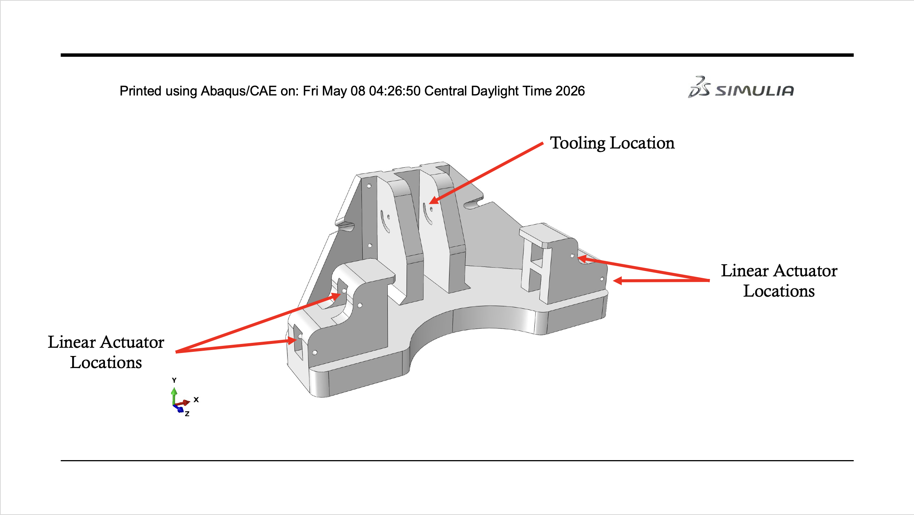
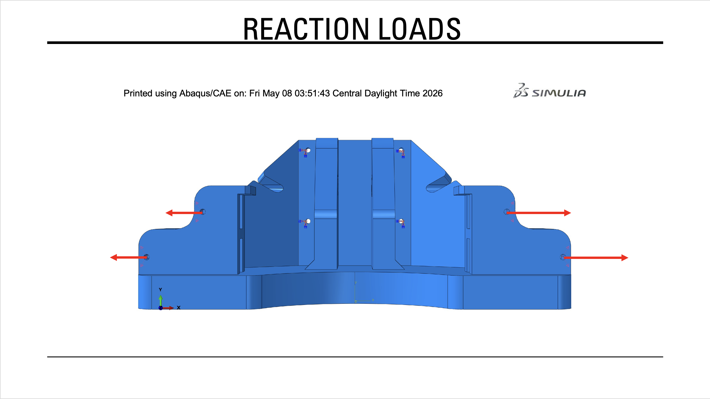
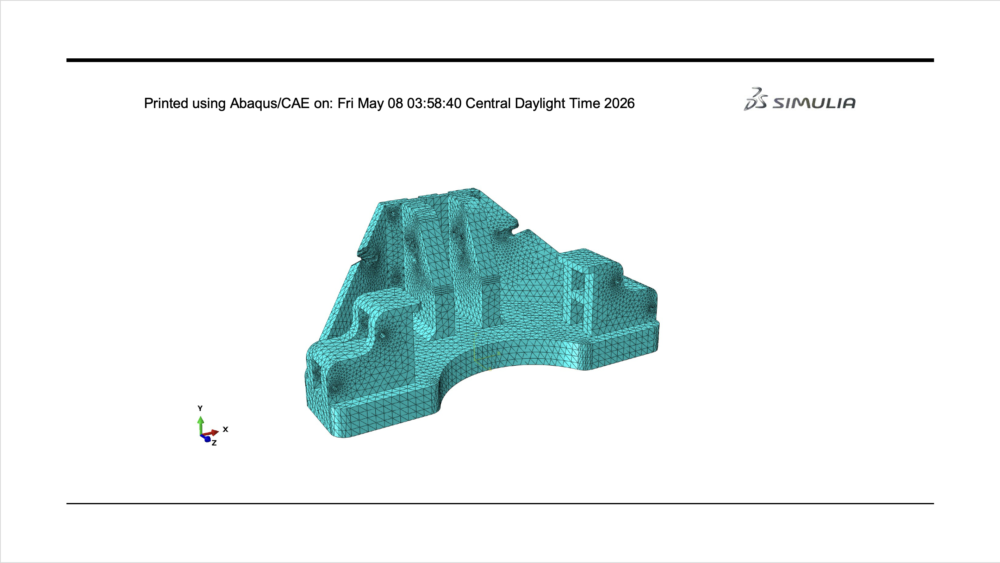
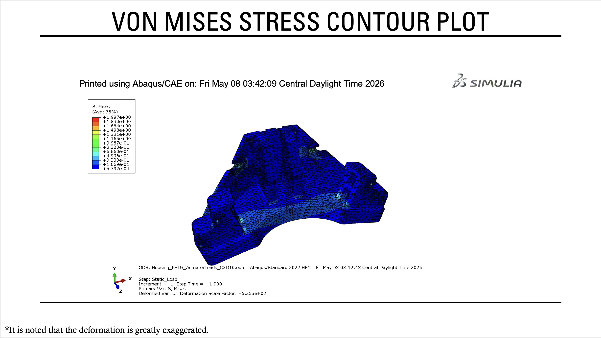
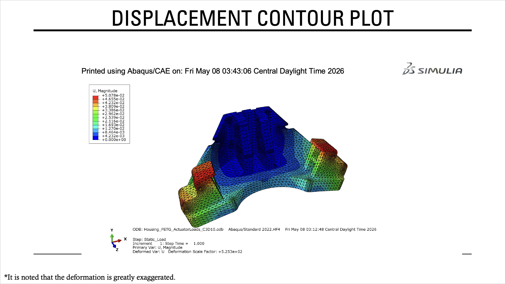

# Tooling-Fixture-FEA-Optimization
# Tooling Housing | Structural FEA & Design Optimization

**Software:** Abaqus/CAE, MATLAB  
**Focus:** Mechanical Design, Finite Element Analysis (FEA), Structural Optimization

## Project Overview

This project involved analyzing and optimizing a PETG housing used in a semi-automatic electromechanical tooling fixture. The housing supports the tooling and linear actuators, which generate reaction forces during operation.

The main objective was to reduce the housing's weight while keeping stress and displacement within acceptable limits and maintaining enough clearance for the surrounding components.

## Engineering Approach

### 1. Structural Analysis — Abaqus/CAE

I used Abaqus/CAE to evaluate the housing's structural behavior under the expected reaction loads.

- Created a 3D finite element model using 10-node quadratic tetrahedral elements (C3D10).
- Applied boundary conditions at the mounting interfaces and distributed loads at the actuator connection points.
- Analyzed von Mises stress and displacement to evaluate the housing's response to loading.

### 2. Design Evaluation

I compared different housing configurations to see how changes in geometry affected weight, stress, and displacement.

The two main dimensions evaluated were:

- **Base thickness:** Reduced to lower material usage and overall weight.
- **Hole depth:** Increased from 37 mm to 42.5 mm to provide the required clearance for surrounding components.

The initial design comparisons showed that reducing the base thickness had the greatest impact on weight. I therefore selected it as the main variable for optimization while keeping the revised hole depth fixed.

### 3. Design Optimization — MATLAB

Using the Abaqus simulation results, I developed linear approximations relating base thickness to mass, stress, and displacement.

I then used MATLAB to determine a lighter design within the following constraints:

- Maximum displacement: 0.060 mm
- Maximum von Mises stress: 2.10 MPa
- Allowable base thickness: 17–20 mm
- Required hole depth: 42.5 mm

The optimization produced a predicted base thickness of approximately **18.34 mm**.

## Results

| Parameter | Result |
|---|---|
| Original Housing Mass | 1,050.76 g |
| Optimized Housing Mass | 988.9 g |
| **Final Predicted Mass Reduction** | **5.9% (61.99 g)** |
| Optimized Base Thickness | 18.34 mm |
| Maximum Predicted von Mises Stress | 1.82 MPa |
| Maximum Predicted Displacement | 0.060 mm |

An earlier design study achieved an **8.3% mass reduction** by decreasing the base thickness to 17 mm. However, that configuration did not include the increased hole depth needed for clearance.

The final MATLAB optimization accounted for this requirement and predicted a **5.9% reduction in mass** while satisfying the specified structural and geometric constraints.

## Key Takeaways

The biggest challenge was finding a way to reduce material without exceeding the displacement limit or creating clearance issues.

Comparing different geometries in Abaqus helped identify which dimensions had the greatest effect on the housing's performance. MATLAB then provided a way to estimate an optimized design based on those results.

This project gave me practical experience connecting FEA results with design decisions and understanding the tradeoffs between weight, stiffness, and component geometry.

## Project Presentation

The full PowerPoint presentation is available in this repository. It includes the housing geometry, applied loads and boundary conditions, Abaqus stress and displacement plots, design comparisons, and MATLAB optimization results.
## Engineering Figures

### Tooling Housing Overview
CAD model showing the housing geometry, tooling location, and linear actuator mounting interfaces.

### Applied Reaction Loads
Reaction forces applied at the actuator mounting interfaces during structural analysis.

### Finite Element Mesh
Abaqus/CAE mesh using 10-node quadratic tetrahedral elements (C3D10).

### Von Mises Stress Analysis
Stress distribution across the housing under the applied loading conditions.

### Displacement Analysis
Displacement distribution showing how the housing deforms under loading.

